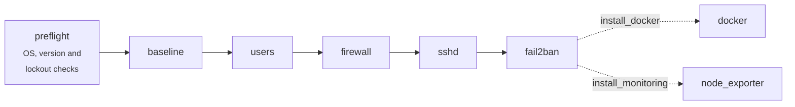

# Ansible Linux Server Automation

[](https://github.com/anastanveer653/ansible-linux-server-automation/actions/workflows/ci.yml)


[](LICENSE)

Turns a fresh Ubuntu, Debian or RHEL-family server into a hardened, monitored host, and keeps it that way on every run.

The roles are idempotent, tested in CI on six distributions with Molecule, and built so that a bad variable can't lock you out of your own server.

```text
$ ansible-playbook site.yml
PLAY RECAP
web01  : ok=115  changed=63  unreachable=0  failed=0
$ ansible-playbook site.yml
web01  : ok=96   changed=0   unreachable=0  failed=0     <- second run changes nothing
```

---

## Contents

- [What it does](#what-it-does)
- [Safety rails](#safety-rails)
- [Quick start](#quick-start)
- [Configuration](#configuration)
- [Day-2 operations](#day-2-operations)
- [Testing](#testing)
- [Design decisions](#design-decisions)
- [Project layout](#project-layout)

## What it does



| Role | What it configures |
|---|---|
| **preflight** | Refuses to touch a host when the OS isn't supported or the run would lock you out (see [Safety rails](#safety-rails)). |
| **baseline** | Distro essentials, timezone and locale, EPEL on EL. Automatic security updates (`unattended-upgrades` / `dnf-automatic`). 28 kernel `sysctl` hardening parameters. Disabled legacy kernel modules. `auditd` with identity, sudoers, sshd, time and kernel-module rules. Core dumps off, `umask 027`. |
| **users** | Non-root admin with SSH keys and sudo (`sudo` / `wheel` per distro). Optional extra users with exclusive keys. Root password locked. Every sudoers file is checked with `visudo`. |
| **sshd** | Hardened drop-in config: key-only auth, no root, `AllowUsers`, no forwarding. Modern crypto, with post-quantum `mlkem768x25519` / `sntrup761x25519` key exchange chosen by detected OpenSSH version. Weak DH moduli removed. SELinux port labelling. Safe port changes. |
| **firewall** | One declarative **nftables** ruleset for every distro: default-deny inbound, per-source SSH rate limiting, source-restricted rules (IPv4 and IPv6), rate-limited drop logging. Replaces ufw / firewalld. |
| **fail2ban** | nftables ban actions, `sshd` jail in aggressive mode, incremental ban time for repeat offenders, `recidive` jail (1-week all-port ban). |
| **docker** | Docker Engine and Compose plugin from Docker's signed repository (deb822 / dnf). `daemon.json` checked with `dockerd --validate`. Published ports bind to `127.0.0.1` by default because Docker bypasses the host firewall. |
| **node_exporter** | Prometheus node_exporter for any CPU architecture, **SHA-256 verified**, upgraded in place when the version changes. Runs as a heavily sandboxed systemd service. |

## Safety rails

Hardening SSH and the firewall is how people lock themselves out of servers. This project treats that as a bug:

| Risk | Protection |
|---|---|
| No SSH key configured, password login disabled | `preflight` fails **before any change** if `users_admin_authorized_keys` is empty. |
| Admin user not in `AllowUsers` | `preflight` fails before any change. |
| Ansible's own connection user (`root`, `ubuntu`) can't log in after hardening | `preflight` fails and tells you to use the bootstrap playbook or switch `ansible_user`. |
| Changing `sshd_port` | The firewall opens the new port **and** keeps the current one. sshd restarts, Ansible waits for the new port and moves its connection to it. The old port closes on the next run. |
| Port change on Ubuntu 22.10+ (`ssh.socket` ignores `Port`) | Socket activation is replaced by a normal `ssh.service`. |
| Port change on SELinux hosts | Port is labelled `ssh_port_t` before sshd restarts. |
| Broken config files | `sshd -t`, `visudo -cf`, `nft -c`, `fail2ban-client --test` and `dockerd --validate` run **before** a file is written or a service restarts. |
| cloud-init re-enabling password login | Settings live in `sshd_config.d/00-hardening.conf`, which sshd reads first, so later drop-ins can't override them. |
| Bad variable types | Every role has `meta/argument_specs.yml`, so options are type-checked when the role starts. |

## Quick start

**Requirements:** ansible-core 2.16+ on your machine. On the servers: SSH access and Python 3.

```bash
git clone https://github.com/anastanveer653/ansible-linux-server-automation.git
cd ansible-linux-server-automation
ansible-galaxy collection install -r requirements.yml

cp inventory/hosts.example.yml inventory/hosts.yml   # git-ignored
$EDITOR inventory/hosts.yml                          # your servers
$EDITOR inventory/group_vars/all.yml                 # at minimum: users_admin_authorized_keys
```

**1. First run on a fresh server.** Connect as `root` (or the cloud image user):

```bash
ansible-playbook playbooks/new-vps-setup.yml -l web01 -e ansible_user=root
```

**2. Every run after that.** Connect as the admin user, which `hosts.example.yml` already sets:

```bash
ansible-playbook site.yml --check --diff   # preview
ansible-playbook site.yml                  # apply
```

## Configuration

Every option is documented in its role's [`defaults/main.yml`](roles/) and type-checked by `meta/argument_specs.yml`. The ones most people change:

| Variable | Default | Purpose |
|---|---|---|
| `users_admin_name` | `sysadmin` | Non-root sudo user |
| `users_admin_authorized_keys` | `[]` | **Required.** Public keys for the admin |
| `users_managed` | `[]` | Extra users: `{name, groups, authorized_keys, sudo, state}` |
| `sshd_port` | `22` | Safe to change, see [Safety rails](#safety-rails) |
| `sshd_allow_users` | `[admin]` | `AllowUsers` list |
| `firewall_allowed_tcp_ports` | `[80, 443]` | Open to the world |
| `firewall_rules` | `[]` | `{port, proto, sources, comment, enabled}` source-restricted rules |
| `firewall_ssh_rate_limit` | `10/minute burst 20 packets` | Per-source new-connection limit |
| `baseline_timezone` | `UTC` | IANA timezone |
| `baseline_auto_updates_reboot` | `false` | Reboot automatically after kernel updates |
| `baseline_sysctl_overrides` | `{}` | Merged over the hardening defaults |
| `install_docker` / `install_monitoring` | `false` | Optional roles |
| `docker_publish_localhost_only` | `true` | `-p 8080:80` binds to `127.0.0.1` |
| `node_exporter_version` | `1.9.1` | Change it to upgrade in place |

Keep secrets such as `users_admin_password_hash` in an Ansible Vault file: `ansible-vault create inventory/group_vars/all/vault.yml`.

## Day-2 operations

```bash
# Only part of the stack
ansible-playbook site.yml --tags ssh,firewall
ansible-playbook playbooks/security-hardening.yml

# Single host, dry run with diff
ansible-playbook site.yml -l web01 --check --diff

# Move SSH to 2222: set sshd_port: 2222, run, then set ansible_port: 2222 in the inventory
ansible-playbook site.yml

# Optional components
ansible-playbook playbooks/setup-docker.yml -l docker_hosts
ansible-playbook playbooks/setup-monitoring.yml
```

Expose node_exporter only to Prometheus:

```yaml
install_monitoring: true
firewall_rules:
  - { port: 9100, proto: tcp, sources: ["10.0.0.5/32"], comment: prometheus }
```

## Testing

Every push and pull request runs:

| Stage | Tooling |
|---|---|
| Lint | `yamllint` and `ansible-lint` on the strict **production** profile |
| Syntax | `ansible-playbook --syntax-check` for every playbook |
| Integration | **Molecule** runs `site.yml` in systemd containers on **Ubuntu 22.04, Ubuntu 24.04, Debian 12, Debian 13, Rocky Linux 9, CentOS Stream 9** |
| Idempotence | A second converge must report `changed=0` |
| Verification | 20+ assertions on live state: effective `sshd -T` settings, loaded nftables rules, active fail2ban jails, a container run through Docker, a node_exporter scrape |

A weekly scheduled run catches breakage from upstream packages and images.

```bash
make deps                     # pip + collections
make lint
make test DISTRO=rockylinux9  # full Molecule run in Docker (also: centos9, debian13, ...)
```

## Design decisions

<details>
<summary><b>Why nftables instead of ufw + firewalld?</b></summary>

Both are front-ends to nftables on current distros. Writing one ruleset directly means:
- the same rules on every distro;
- the whole ruleset is replaced atomically and declaratively, so an old rule disappears when you remove it from the variables (ufw can only add rules, not converge to a desired state);
- it is validated with `nft -c` before it is loaded.

The project owns only the `inet hardening` table and never runs `flush ruleset`, so Docker's and fail2ban's tables survive a reload.
</details>

<details>
<summary><b>Why an sshd drop-in instead of templating sshd_config?</b></summary>

sshd keeps the **first** value it reads for an option. A file included at the top of `sshd_config` wins over the distro defaults and over files that cloud-init writes later, such as `50-cloud-init.conf` with `PasswordAuthentication yes`. The distro's own `sshd_config`, including its correct `Subsystem sftp` path, stays intact.
</details>

<details>
<summary><b>Why no SSH cipher list on RHEL / Rocky / Alma / CentOS Stream?</b></summary>

On the RHEL family, SSH crypto is controlled system-wide by `crypto-policies`. Overriding it per daemon goes against vendor guidance and can break FIPS mode. Use `update-crypto-policies --set FUTURE` instead. On Debian and Ubuntu, the role sets explicit Kex, Cipher and MAC allow-lists.
</details>

<details>
<summary><b>Why does Docker bind published ports to 127.0.0.1?</b></summary>

Docker writes its own iptables/nftables rules, so `docker run -p 5432:5432` exposes the port to the internet **regardless of the host firewall**. With `"ip": "127.0.0.1"` in `daemon.json`, publishing a service to the world becomes a deliberate act: `-p 0.0.0.0:443:443`.
</details>

<details>
<summary><b>Why does the bootstrap playbook run sshd last?</b></summary>

As soon as sshd restarts, `root` and the cloud image user can no longer open new SSH connections. Running sshd last means every other role finishes on the original connection.
</details>

## Supported platforms

Exactly what the CI matrix tests. Other versions are refused by `preflight` unless you override `preflight_supported_os`.

| Distribution | Versions |
|---|---|
| Ubuntu | 22.04, 24.04 |
| Debian | 12, 13 |
| Rocky Linux / AlmaLinux / RHEL | 9 |
| CentOS Stream | 9 |

CentOS Linux 7 and 8 are end-of-life and receive no security updates, so they are deliberately not supported.

## Project layout

```text
.
├── site.yml                    # full stack
├── playbooks/
│   ├── new-vps-setup.yml       # first run as root / cloud user
│   ├── security-hardening.yml  # firewall + sshd + fail2ban
│   ├── setup-docker.yml
│   └── setup-monitoring.yml
├── inventory/
│   ├── hosts.example.yml       # copy to hosts.yml (git-ignored)
│   └── group_vars/all.yml      # shared settings
├── roles/<role>/
│   ├── defaults/main.yml       # every option, documented
│   ├── meta/argument_specs.yml # type checking
│   ├── vars/{Debian,RedHat}.yml
│   ├── tasks/ handlers/ templates/
├── molecule/default/           # converge -> idempotence -> verify
├── molecule/images/            # CentOS Stream 9 systemd test image
└── .github/workflows/ci.yml    # lint + 6-distro Molecule matrix
```

## License

[MIT](LICENSE) © Anas Tanveer
